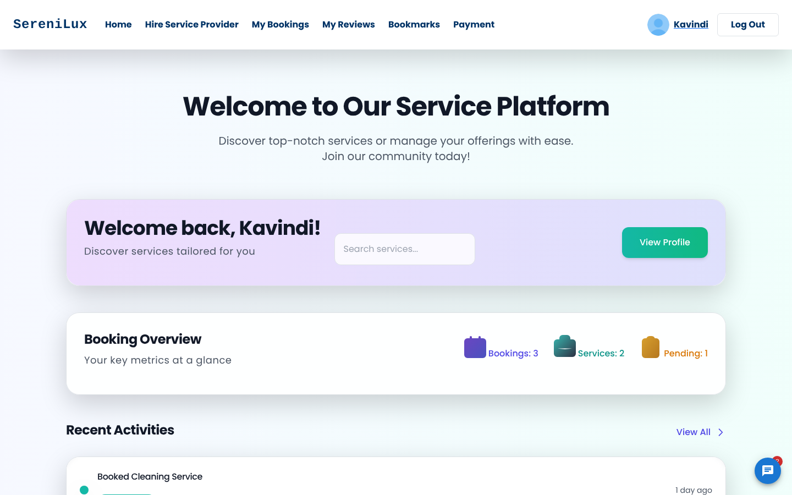
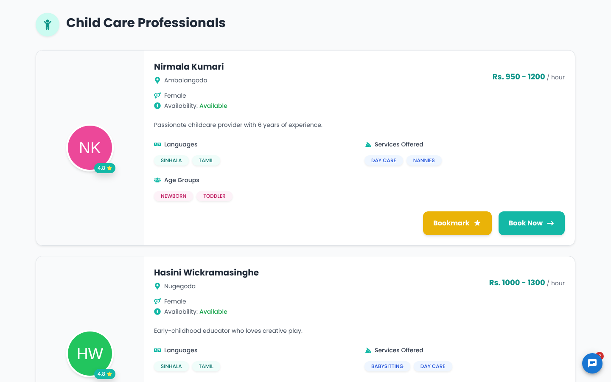
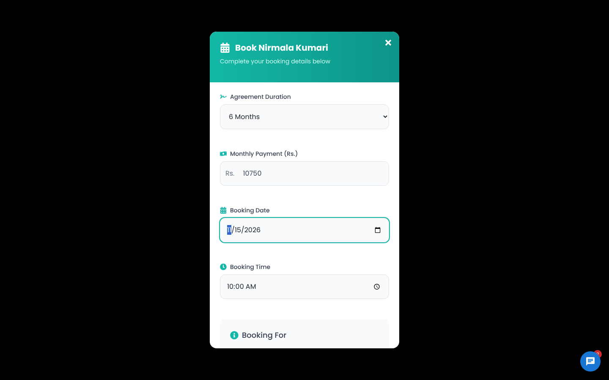
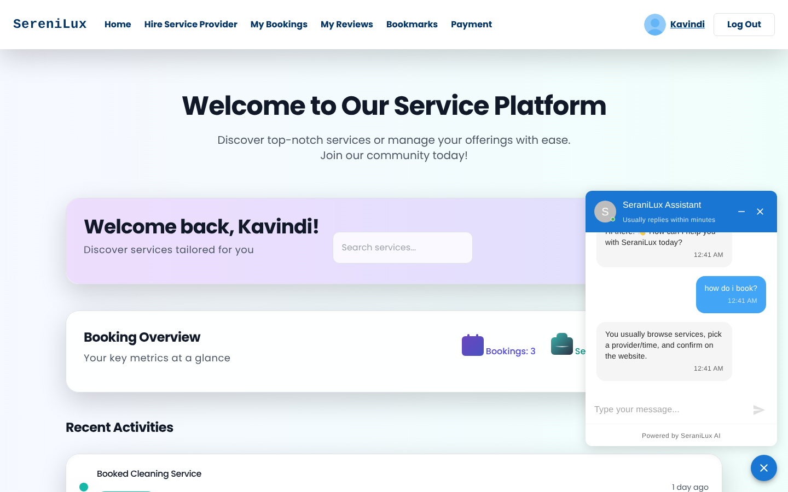
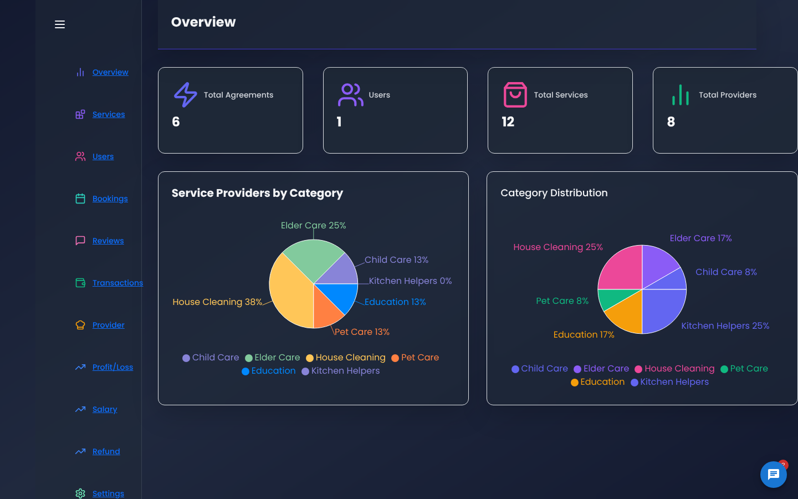

# SereniLux – All-in-One Personal Assistance App

SereniLux is a full-stack web platform that connects customers with local service providers for everyday household and personal needs: house cleaning, kitchen help, elder care, child care, pet care and education/tutoring. Customers can browse and book services, pay online, leave reviews and get instant help from an AI chatbot. Service providers manage their own profiles and bookings, and administrators get a full financial dashboard covering revenue, expenses, salaries, refunds and profit & loss.

## 📸 Screenshots

### Home


### Booking Flow



### AI Chatbot


### Admin Dashboard


---

## ✨ Features

### 👤 Customers
- Sign up / log in with JWT authentication
- Browse service categories and choose a provider
- Book services and track them under **My Bookings**
- Bookmark favourite providers
- Write and manage reviews
- Online payments, saved payment methods, payment history and refund history
- **AI chatbot** for instant help with questions about the platform

### 🧰 Service Providers
- Create, view, edit and delete a provider account
- Choose the services offered (House Cleaning, Kitchen, Elder Care, Pet Care, Child Care, Education)
- Provider dashboard to manage bookings

### 🛠️ Admin Dashboard
- Overview with stat cards and charts (Recharts)
- Manage users, customers, service providers, services and bookings
- Moderate customer reviews
- Financial management: revenue, expenses, transactions and **profit & loss** reports
- **Salary calculation**: set rates, approve salaries, view top earners, generate payslip PDFs and email them
- Refund management
- PDF report export (jsPDF)

### 🤖 AI Chatbot
- Floating chat assistant available across the app
- Answers common FAQs instantly using built-in rules
- Falls back to **Google Gemini** (`gemini-1.5-flash`) for open-ended questions
- Conversation history saved and restored per conversation

### 💳 Payments
- **Stripe** Checkout and **PayHere** payment gateway integration
- Scheduled job (node-cron) that automatically completes pending payments
- Email notifications via Nodemailer

---

## 🧱 Tech Stack

| Layer | Technologies |
|---|---|
| **Frontend** | React 19, React Router, Tailwind CSS, Material UI, Bootstrap, Framer Motion, Recharts, Axios, SweetAlert2, jsPDF |
| **Backend** | Node.js, Express.js |
| **Database** | MongoDB with Mongoose and Prisma ORM |
| **Auth & Security** | JWT, bcrypt, Speakeasy (OTP) |
| **AI** | Google Generative AI (Gemini) |
| **Payments** | Stripe, PayHere |
| **Other** | Nodemailer, node-cron, pdf-lib |

---

## 📁 Project Structure

```
All-in-one-Personal-Assistance-App/
├── Backend/
│   ├── config/          # Prisma config & seed data
│   ├── controllers/     # Chatbot controller
│   ├── middlwares/      # JWT token validation
│   ├── models/          # Mongoose models & payment logic
│   ├── prisma/          # Prisma schema
│   ├── routes/          # Express API routes
│   ├── services/        # Chatbot, mail, payslip PDF, payment scheduler
│   └── server.js        # App entry point (port 8070)
└── Frontend/
    └── personal-assistance-app/
        └── src/
            ├── Component/
            │   ├── Pages/   # Customer, service provider & admin pages
            │   └── UI/      # Reusable UI & admin dashboard components
            ├── Lib/         # API client & utilities
            └── Routes/      # Protected / admin routes
```

---

## 🚀 Getting Started

### Prerequisites
- Node.js 18+
- MongoDB (local or MongoDB Atlas)
- npm or Yarn

### 1. Clone the repository
```bash
git clone https://github.com/RashmiRathnayaka/All-in-one-Personal-Assistance-App.git
cd All-in-one-Personal-Assistance-App
```

### 2. Set up the backend
```bash
cd Backend
npm install
npx prisma generate
```

Create a `.env` file in `Backend/`:
```env
PORT=8070
MONGO_URL=your_mongodb_connection_string
JWT_SECRET=your_jwt_secret
GOOGLE_API_KEY=your_gemini_api_key
STRIPE_SECRET_KEY=your_stripe_secret_key
PAYHERE_MERCHANT_ID=your_payhere_merchant_id
PAYHERE_SECRET_KEY=your_payhere_secret
```

Start the server:
```bash
npm start
```
The API runs at `http://localhost:8070`.

### 3. Set up the frontend
```bash
cd ../Frontend/personal-assistance-app
npm install
npm start
```
The app runs at `http://localhost:3000`.

---

## 🔌 Main API Routes

| Route | Purpose |
|---|---|
| `/api/auth` | Register, login, OTP |
| `/api/user` | User profile (protected) |
| `/api/service-provider` | Provider account (protected) |
| `/home/serviceProvider` | Service provider listings |
| `/home/booking` | Bookings |
| `/home/payment` | Payments & saved payment methods |
| `/home/Refund` | Refunds |
| `/api` | PayHere payment gateway |
| `/api/chat` | AI chatbot |
| `/admin`, `/api/admin` | Admin features & review moderation |
| `/adminDashBoard/Financial` | Revenue, expenses & financial activity |

---

## 👥 Contributors

- Rashmi Rathnayaka – [@RashmiRathnayaka](https://github.com/RashmiRathnayaka)
- Dinithi Gamage

---

## 📄 License

This project was developed for academic purposes.
